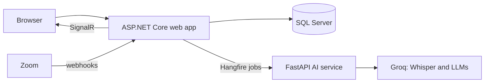

# Briefyn AI

[](https://github.com/sametulas57/BriefynAI/actions/workflows/test.yml)

Briefyn is an AI meeting assistant for teams. Upload a recording or connect Zoom, and Briefyn produces a transcript, summary, key decisions, action items, and open topics in a searchable team archive.

**Status:** pre-launch. The application runs locally with Docker; it is not yet in production.

## Features

- **Meeting analysis:** transcription and structured summaries from uploaded recordings or Zoom cloud recordings.
- **Team workspaces:** invitations, roles, comments, and meeting summaries shared by email.
- **Action tracking:** assignable action items, a personal task page, and email reminders for overdue tasks.
- **Meeting series:** recurring meetings with a live agenda built from open tasks and pending topics.
- **Ask the Archive:** natural-language questions across past meetings, answered with the source meeting (RAG with keyword retrieval).
- **Zoom integration:** OAuth 2.0 connection and webhooks that import cloud recordings, including speaker names.
- **Privacy:** encrypted transcripts, audio deleted after processing, and an AI provider running with zero data retention.

## Architecture



- `MeetingWeb/`: ASP.NET Core Razor Pages app with Identity, EF Core, Hangfire, and SignalR.
- `ai_engine/`: Python FastAPI service for transcription, summaries, and answers.
- `MeetingWeb.Tests/`, `ai_engine/tests/`: xUnit and pytest suites.
- `docs/kararlar/`: architecture decision records (in Turkish).

## Getting started

Requires Docker and a [Groq](https://groq.com) API key.

```bash
cp .env.example .env
```

Fill in `.env`, then start the stack:

```bash
docker compose up -d --build
```

The app runs at http://127.0.0.1:8080.

## Tests

```bash
dotnet test MeetingWeb.Tests
```

```bash
pip install -r ai_engine/requirements.txt -r ai_engine/requirements-dev.txt
python -m pytest ai_engine/tests
```

Tests run on every push with GitHub Actions.
